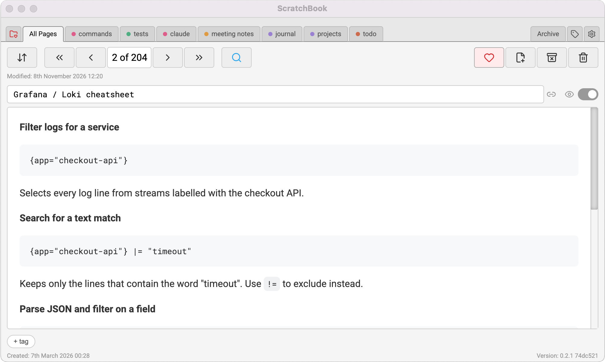
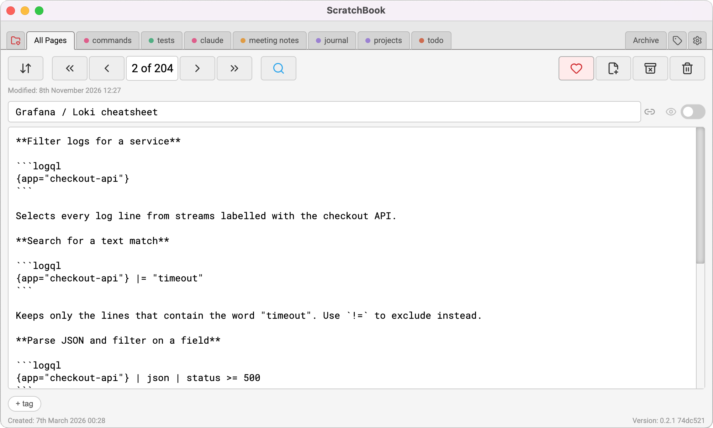
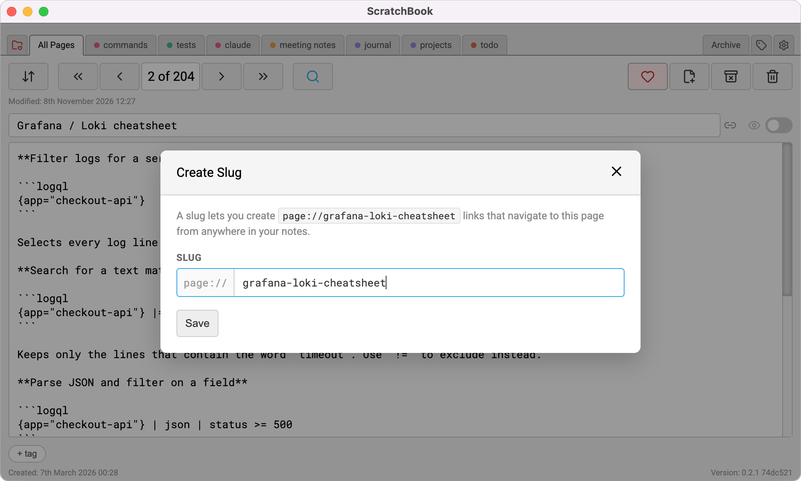
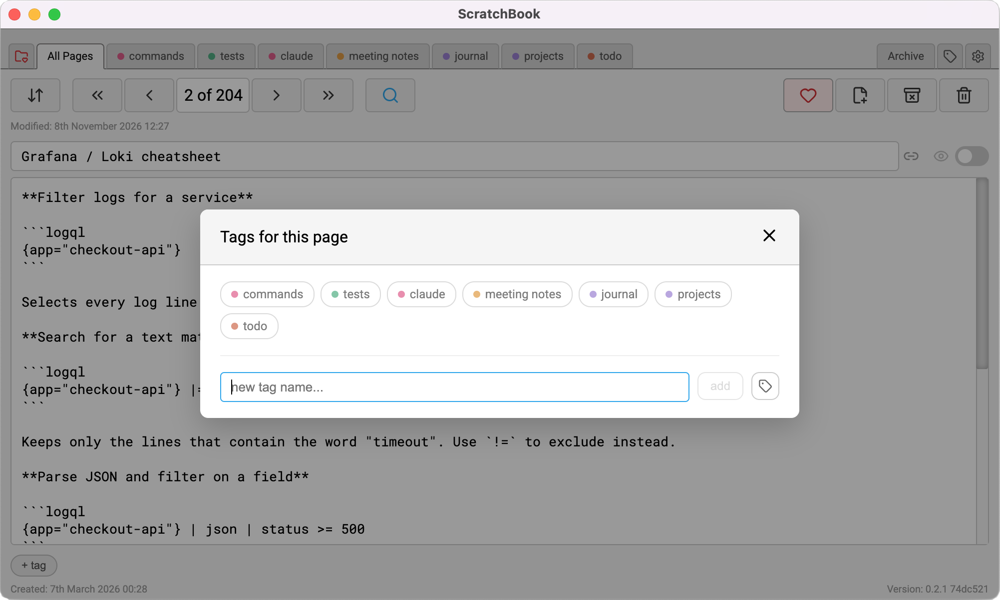
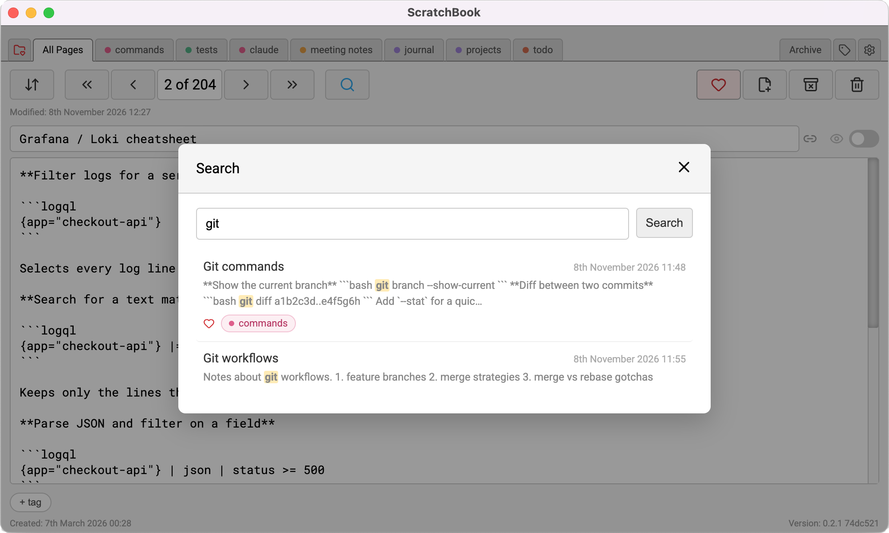
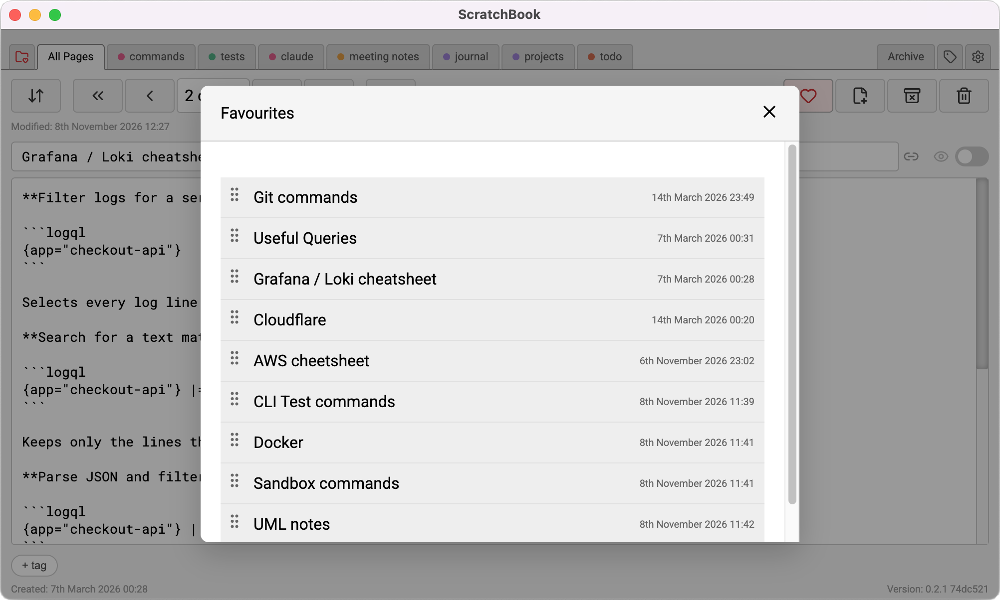
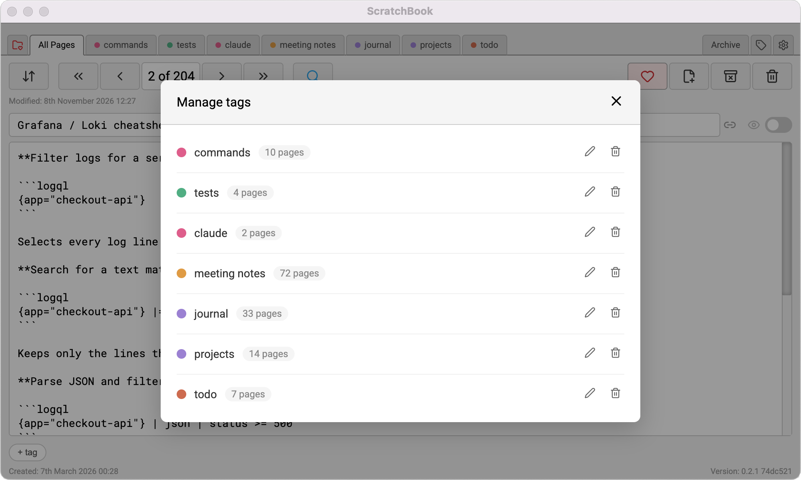

# ScratchBook

## Overview

ScratchBook is an opinionated page based scratch-pad and notes app with local storage.

ScratchBook is privacy first - your data never leaves your device unless you explicitly setup sync using third-party apps like Dropbox to watch and update the storage directory.

## Features

### Preview view



### Markdown view



### Page slug

Add slugs to pages for internal links.



### Page tags

Add tags to organise pages.



### Search

Full text search using MiniSearch.



### Favourites

Quick access to favourites 



### Manage tags




## Tech stack

- Electron + `electron-vite`
- Vue 3 + Vue Router
- IndexedDB (`idb`) for fast local cache
- Filesystem page bundles for canonical persisted data
- Vitest + Vue Test Utils for tests
- MiniSearch (full text search) 

## Storage model

- Page data is stored on disk as bundle folders: `<createdAt>/index.md`.
- IndexedDB mirrors page data for fast UI operations.
- Metadata files mirrored to disk:
  - `tag_meta.json`
  - `orderings.json`
  - `settings.json`
- Sync trigger token:
  - `_sync_state.json`

## Scripts

```bash
npm install
npm run dev
npm run build
npm test
npm run lint
npm run lint:fix
npm run format
```

## Building and installing the Electron app

ScratchBook is packaged with `electron-builder`. The app identity (`productName`, `appId`) and per-platform icons are configured under the `build` key in `package.json`, with icons in `build/icons`.

### Prerequisites

- Node.js and npm
- Dependencies installed with `npm install`. The `postinstall` step runs `electron-builder install-app-deps` to rebuild native modules for Electron.
- To build for macOS, run on a Mac. To build for Windows or Linux, use that platform's build script on a matching machine.

### Run the built app without installing

```bash
npm run build
npm start
```

`npm run build` compiles the main, preload and renderer bundles into `out/`. `npm start` runs that output with `electron-vite preview`.

### Package an installable app

```bash
npm run build:mac     # macOS (.dmg and .zip)
npm run build:win     # Windows installer
npm run build:linux   # Linux packages
```

Each script runs `npm run build` first, then `electron-builder` for the chosen platform. Packaged artifacts are written to `build/`. That directory is gitignored, except for `build/icons`.

### Install

- **macOS:** open the `ScratchBook-<version>.dmg` from `build/` and drag ScratchBook into `Applications`. Builds that are not code-signed may be blocked by Gatekeeper on first launch. In that case, right-click the app and choose **Open**.
- **Windows:** run the generated installer from `build/`.
- **Linux:** install or run the package generated in `build/`, using the format that matches your distribution.

### Versioning

The version comes from the `version` field in `package.json`, and it is written into the artifact file names.

Bump it before building a new release.

## Sync behaviour

- The main process can watch `_sync_state.json` and notify the renderer. This can be enabled in settings.
- The renderer `SyncService` reconciles filesystem changes back into IndexedDB and in-memory indexes.
- Import/export is handled via main-process IPC handlers.

## Testing

- Unit and component tests live under `tests/renderer`.
- Run all tests with:

```bash
npm test
```
